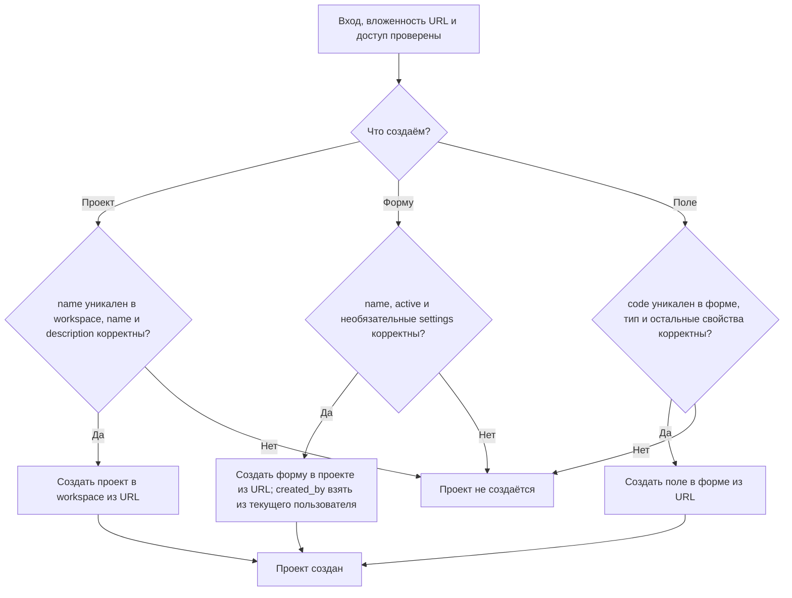
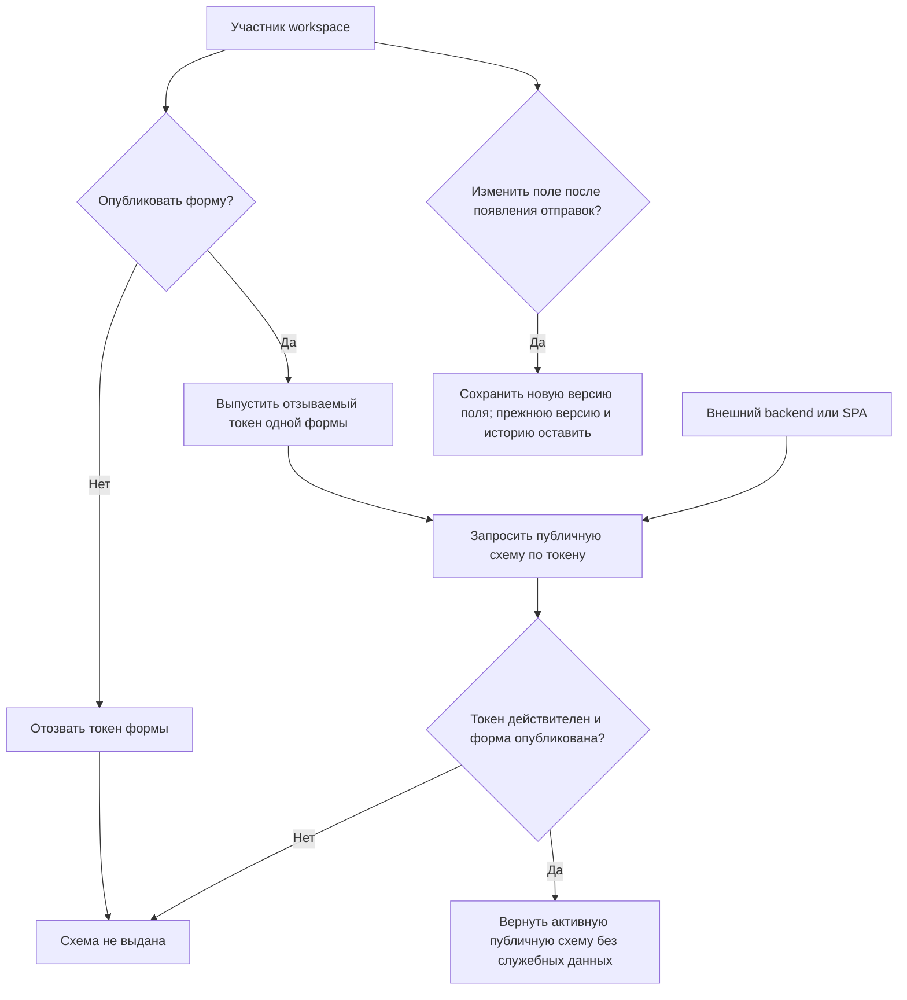

# Проекты, формы и поля

Статус: текущее поведение (`as-is`). Модуль `FormDefinition`. [Общий обзор](overview.md). Все операции проходят [аутентификацию](identity.md) и [проверку membership и вложенности](tenancy.md).

## Создание определения

Точные JSON-поля, допустимые значения, вложенность ресурсов и HTTP-результаты описаны в [OpenAPI](../api/openapi.yaml). Технические границы модулей и модели — в [архитектурной спецификации](../architecture.md).

## Целевое поведение первой версии (не реализовано)

Публичный токен — отзывной маркер доступа к одной форме, а не секрет: он разрешает только чтение её публичной схемы и создание отправок. Клиент не получает административные операции или доступ к сохранённым отправкам. При серверной интеграции секреты остаются на backend. Точные маршруты и схемы запроса/ответа будут определены в R02–R03; плановое направление указано в [OpenAPI](../api/openapi.yaml).

## Основания

- [Маршруты и привязка родителей](../../routes/api.php), [policy формы](../../app/Modules/FormDefinition/Infrastructure/Policies/FormPolicy.php).
- [Создание проекта](../../app/Modules/FormDefinition/Presentation/Http/Requests/StoreProjectRequest.php), [формы](../../app/Modules/FormDefinition/Presentation/Http/Requests/StoreFormRequest.php), [поля](../../app/Modules/FormDefinition/Presentation/Http/Requests/StoreFormFieldRequest.php), [обновление поля](../../app/Modules/FormDefinition/Presentation/Http/Requests/UpdateFormFieldRequest.php), [типы](../../app/Modules/FormDefinition/Domain/Form/FieldType.php).
- [Сохранение формы](../../app/Modules/FormDefinition/Infrastructure/Repository/FormRepository.php).
- [Тесты проектов](../../tests/Feature/Modules/FormDefinition/Presentation/Http/Controller/ProjectControllerTest.php), [форм](../../tests/Feature/Modules/FormDefinition/Presentation/Http/Controller/FormControllerTest.php) и [полей](../../tests/Feature/Modules/FormDefinition/Presentation/Http/Controller/FormFieldControllerTest.php).
