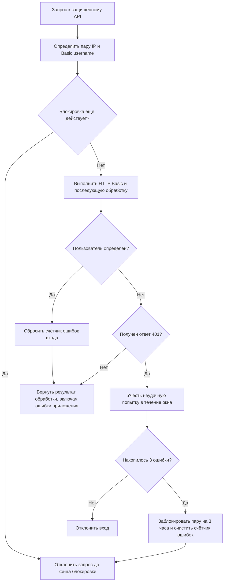

# Вход и ограничение попыток

Статус: текущее поведение (`as-is`). Модуль `Identity`. [Общий обзор](overview.md).

## Проверка запроса

Диаграмма — единственное описание последовательности бизнес-сценария входа. Состав HTTP-ответов и заголовки описаны в [OpenAPI](../api/openapi.yaml); реализация и подтверждающие тесты приведены ниже.

## Основания

- [Middleware](../../app/Modules/Identity/Presentation/Http/Middleware/ThrottleAuthenticationFailures.php), [resolver](../../app/Modules/Identity/Presentation/Http/Middleware/RequestAuthenticationAttemptIdentityResolver.php) и [limiter](../../app/Modules/Identity/Infrastructure/Security/AuthenticationAttemptLimiter.php).
- [Регистрация зависимостей](../../app/Providers/PresentationServiceProvider.php).
- [Тесты HTTP-поведения](../../tests/Feature/Modules/Identity/Presentation/Http/Middleware/ThrottleAuthenticationFailuresTest.php) и [тесты ограничителя](../../tests/Feature/Modules/Identity/Infrastructure/Security/AuthenticationAttemptLimiterTest.php).
