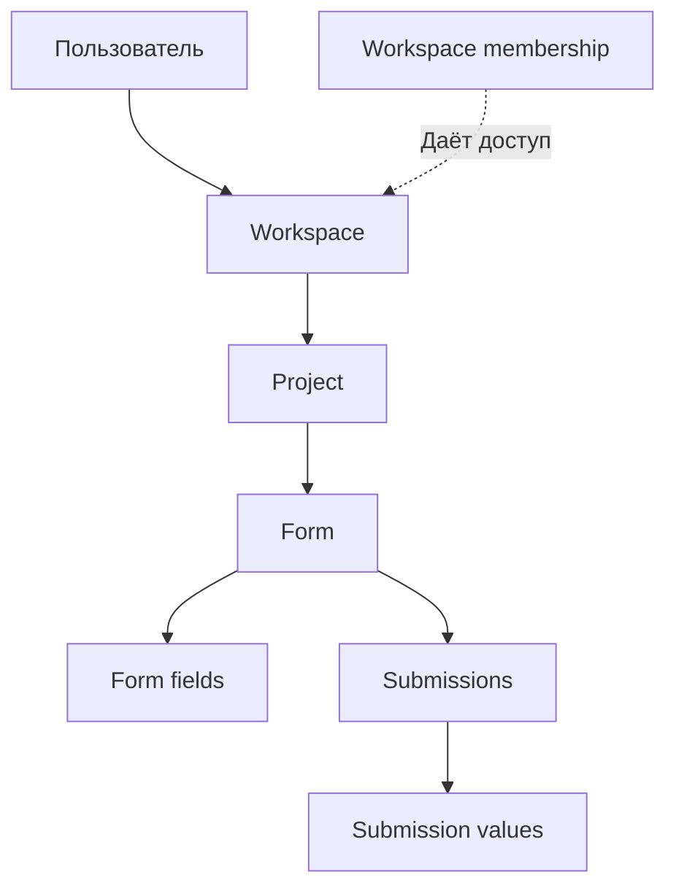

# Бизнес-логика FormFlow

## Роль документа

Это навигационная схема, а не вторая подробная спецификация: каждый сценарий описан ровно в одном документе модуля ниже.

## Общая блок-схема

Модели и связи подтверждай кодом. Транспортный контракт и HTTP-поведение принадлежат [OpenAPI](../api/openapi.yaml); границы модулей и технические решения — [архитектурной спецификации](../architecture.md).

## Сценарии по модулям

| Документ | Содержание |
| --- | --- |
| [Вход и ограничение попыток](identity.md) | Проверка блокировки, ошибки входа, сброс счётчика |
| [Workspace, участники и доступ](tenancy.md) | Создание workspace, membership, изоляция, актуальность списков |
| [Проекты, формы и поля](form-definition.md) | Создание определений, принадлежность родителей, уникальность |
| [Отправленные ответы](submissions.md) | Создание submission, добавление и изменение значений |

## Поддержка схем

Каждая сценарная диаграмма встроена в единственный документ-владелец; отдельную копию диаграммы или пересказ её узлов не создавай. Mermaid здесь — наглядное представление потока, а не источник HTTP-деталей или архитектурных решений. GitHub отображает fenced-блоки Mermaid. См. [формат блоков в GitHub](https://docs.github.com/en/get-started/writing-on-github/working-with-advanced-formatting/creating-diagrams) и [синтаксис flowchart](https://mermaid.js.org/syntax/flowchart.html).

При изменении бизнес-сценария применяй [formflow-business-logic](../../.agents/skills/formflow-business-logic/SKILL.md); он указывает, какой единственный сценарный документ обновлять.
