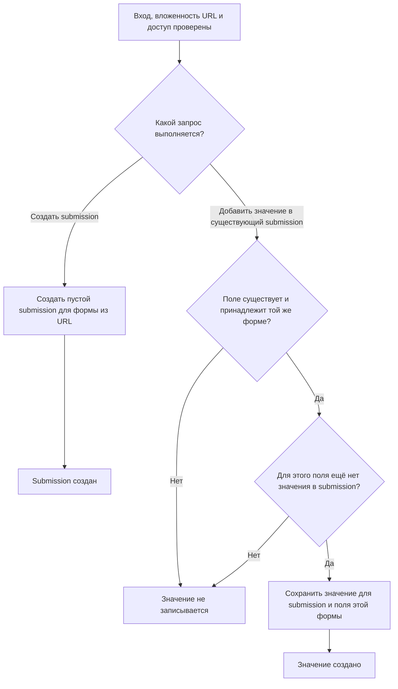
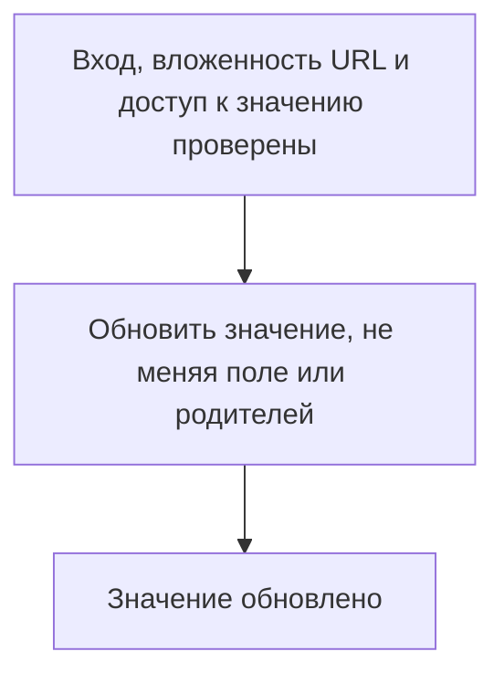
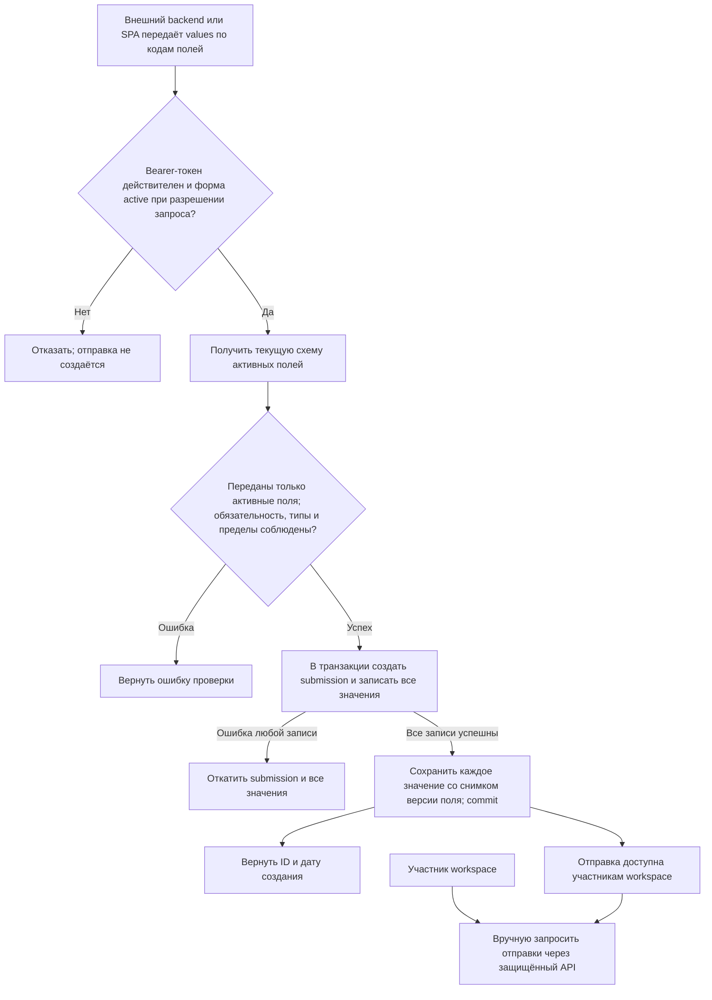

# Отправленные ответы

Статус: текущее поведение (`as-is`). Модуль `Submissions`. [Общий обзор](overview.md). Перед каждым запросом выполняются [аутентификация](identity.md) и [проверка membership и всей цепочки родителей](tenancy.md).

## Создание submission и значения

Точная форма запроса и ответа принадлежит [OpenAPI](../api/openapi.yaml).

## Изменение значения

Диаграммы не добавляют проверок по типу поля или его флагам `active`/`required`: такой путь сейчас не реализован. Формат значений и HTTP-результаты описывает [OpenAPI](../api/openapi.yaml); модели — [архитектурная спецификация](../architecture.md).

## Публичная отправка (R02–R05 реализованы)

Публичный Bearer-токен не даёт права читать отправки; такие маршруты остаются только под HTTP Basic и membership. Правила активных полей, типов, ограничений значений и размера запроса описаны в [OpenAPI](../api/openapi.yaml). `values` должен содержать хотя бы одно значение, даже если в форме нет обязательных полей. Неактивное обязательное поле не требуется; присланное значение неактивного поля отклоняется. Middleware проверяет активность формы при каждом публичном запросе, поэтому ранее загруженная клиентом схема не позволяет отправить форму после выключения. Значение сохраняет ID неизменяемой версии определения, по которой оно было принято; изменение и архивирование поля не меняют историю. У формы нет кеша публичной схемы. Отклонённая отправка не создаёт ни submission, ни значений. Оператору не обещаются уведомления или срок чтения.

## Основания

- [Маршруты](../../routes/api.php), [middleware публичного токена](../../app/Modules/FormDefinition/Presentation/Http/Middleware/ResolvePublicFormToken.php), [контроллер submission](../../app/Modules/Submissions/Presentation/Http/Controller/SubmissionController.php), [Action публичной отправки](../../app/Modules/Submissions/Application/Actions/CreatePublicSubmissionAction.php), [валидация HTTP-тела](../../app/Modules/Submissions/Presentation/Http/Requests/StorePublicSubmissionRequest.php).
- [Валидация создания значения](../../app/Modules/Submissions/Presentation/Http/Requests/StoreSubmissionValueRequest.php) и [обновления](../../app/Modules/Submissions/Presentation/Http/Requests/UpdateSubmissionValueRequest.php).
- [Репозиторий submission](../../app/Modules/Submissions/Infrastructure/Repository/SubmissionRepository.php) и [значений](../../app/Modules/Submissions/Infrastructure/Repository/SubmissionValueRepository.php).
- [Тесты публичной отправки](../../tests/Feature/Modules/Submissions/Presentation/Http/Controller/PublicSubmissionControllerTest.php), [submission](../../tests/Feature/Modules/Submissions/Presentation/Http/Controller/SubmissionControllerTest.php) и [значений](../../tests/Feature/Modules/Submissions/Presentation/Http/Controller/SubmissionValueControllerTest.php).
