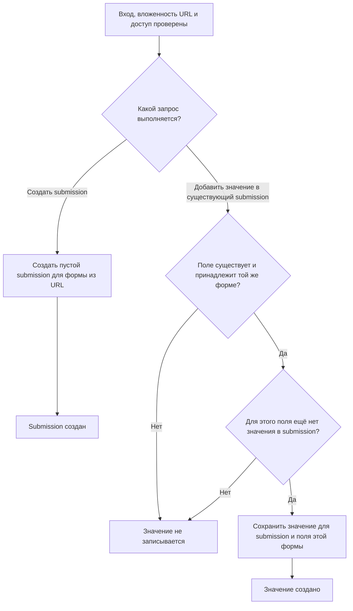
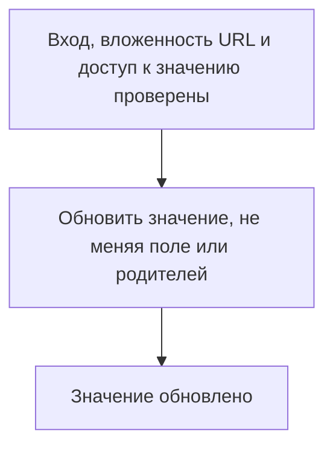
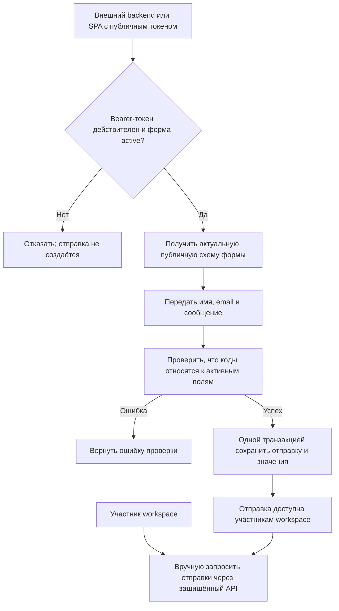

# Отправленные ответы

Статус: текущее поведение (`as-is`). Модуль `Submissions`. [Общий обзор](overview.md). Перед каждым запросом выполняются [аутентификация](identity.md) и [проверка membership и всей цепочки родителей](tenancy.md).

## Создание submission и значения

Точная форма запроса и ответа принадлежит [OpenAPI](../api/openapi.yaml).

## Изменение значения

Диаграммы не добавляют проверок по типу поля или его флагам `active`/`required`: такой путь сейчас не реализован. Формат значений и HTTP-результаты описывает [OpenAPI](../api/openapi.yaml); модели — [архитектурная спецификация](../architecture.md).

## Публичная отправка (R02 реализован; правила значений продолжаются в R03)

Публичный Bearer-токен не даёт права читать отправки; такие маршруты остаются только под HTTP Basic и membership. Текущая внешняя операция отклоняет неизвестные и неактивные коды, атомарно сохраняет полученные значения и не доверяет parent/owner полям тела. Проверка типов, обязательных значений и версий схемы уточняется в R03–R05. Оператору не обещаются уведомления или срок чтения.

## Основания

- [Маршруты](../../routes/api.php), [контроллер submission](../../app/Modules/Submissions/Presentation/Http/Controller/SubmissionController.php), [создание submission](../../app/Modules/Submissions/Presentation/Http/Requests/StoreSubmissionRequest.php).
- [Валидация создания значения](../../app/Modules/Submissions/Presentation/Http/Requests/StoreSubmissionValueRequest.php) и [обновления](../../app/Modules/Submissions/Presentation/Http/Requests/UpdateSubmissionValueRequest.php).
- [Репозиторий submission](../../app/Modules/Submissions/Infrastructure/Repository/SubmissionRepository.php) и [значений](../../app/Modules/Submissions/Infrastructure/Repository/SubmissionValueRepository.php).
- [Тесты submission](../../tests/Feature/Modules/Submissions/Presentation/Http/Controller/SubmissionControllerTest.php) и [значений](../../tests/Feature/Modules/Submissions/Presentation/Http/Controller/SubmissionValueControllerTest.php).
