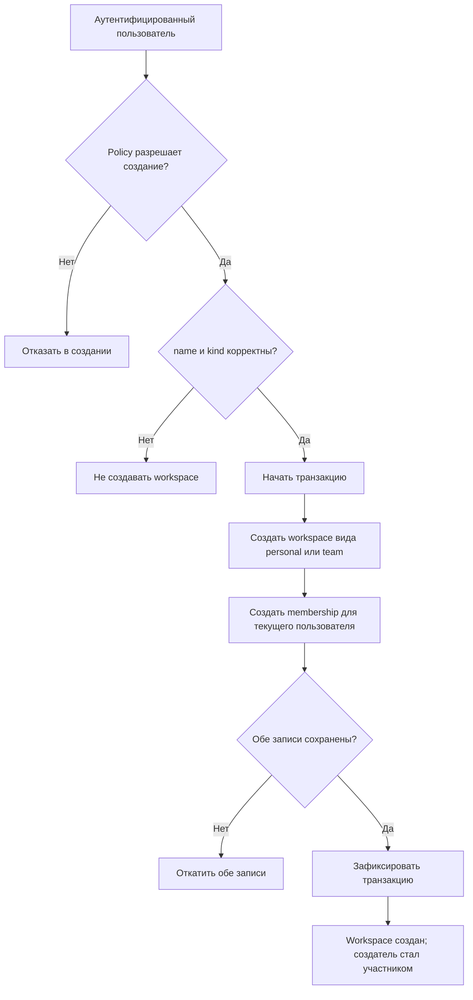
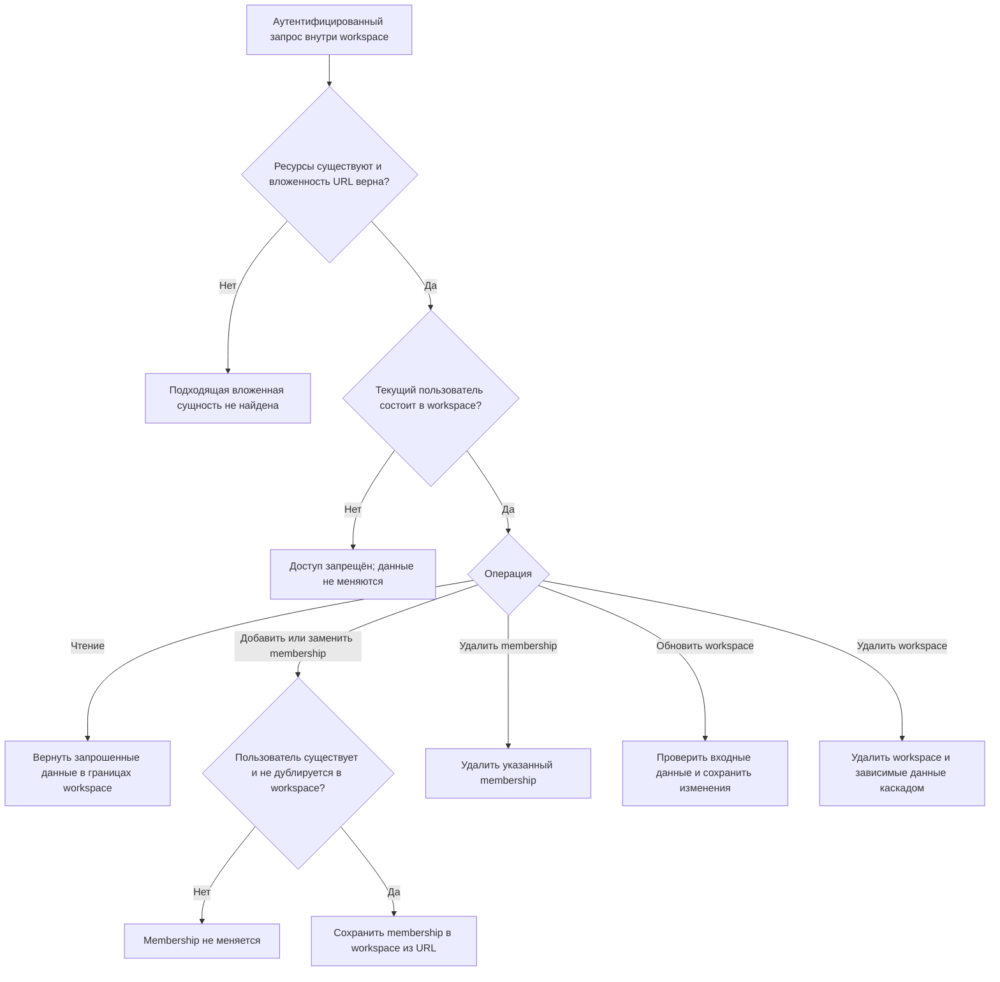

# Workspace, участники и доступ

Статус: текущее поведение (`as-is`). Модуль `Tenancy`. [Общий обзор](overview.md). Вход выполняется по [общей схеме аутентификации](identity.md).

## Создание workspace

Поля запроса и HTTP-результаты определены в [OpenAPI](../api/openapi.yaml). Техническая атомарность и обновление кеша относятся к [архитектуре и реализации](../architecture.md).

## Работа с существующими данными

Правила доступа и HTTP-результаты описывает [OpenAPI](../api/openapi.yaml). Кеш и эффекты после commit — технические детали; см. [правила кеша workspace](../../.agents/skills/formflow-tenancy/references/workspace-cache.md).

## Основания

- [Реализация и политики доступа](../../app/Modules/Tenancy/Infrastructure/Policies/WorkspacePolicy.php), [атомарное создание](../../app/Modules/Tenancy/Infrastructure/Repository/WorkspaceRepository.php).
- [Feature-тесты сценария](../../tests/Feature/Modules/Tenancy/Presentation/Http/Controller/WorkspaceControllerTest.php) и [membership](../../tests/Feature/Modules/Tenancy/Presentation/Http/Controller/WorkspaceMembershipControllerTest.php).
